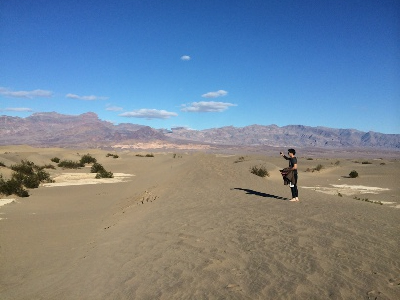
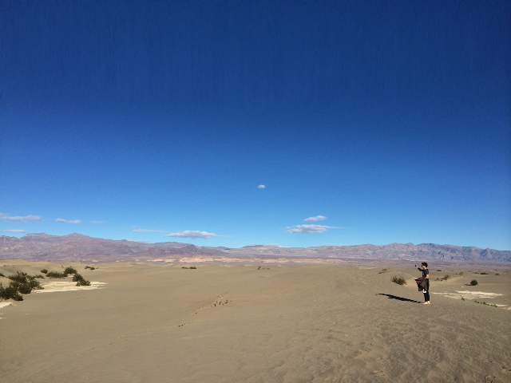
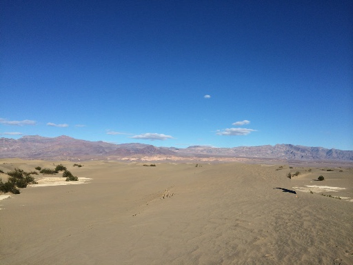
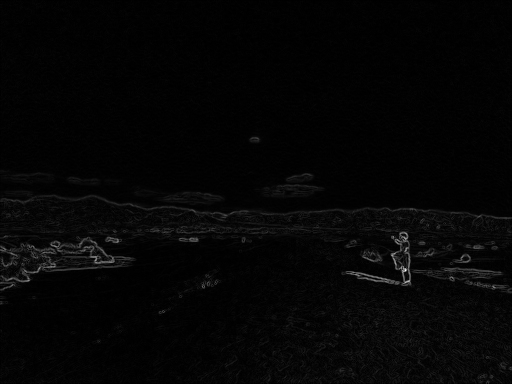
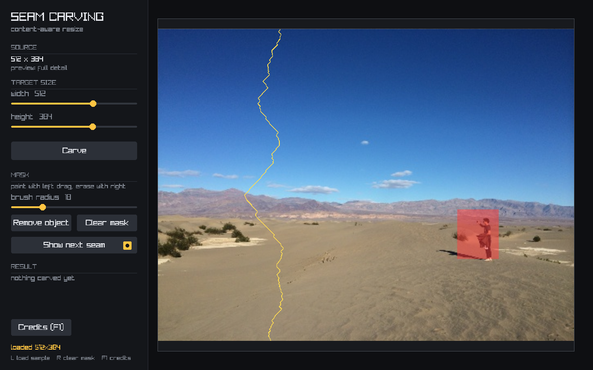

# Seam Carving in C++

Content-aware image resizing: remove or insert the paths of pixels that matter
least, instead of scaling the whole image. A C++ port of
[vivianhylee/seam-carving](https://github.com/vivianhylee/seam-carving), with a
raylib interface on top.

Sherwyn Low · Lim Rui Heng · Tea Zhi Xun · Sim Wei Siang · Teo Pek Lin · Loh Jun Wei


## Build

Requirements: CMake 3.20+, a C++20 compiler (Visual Studio 2022), Ninja, and
network access on the first configure so CMake can fetch raylib 5.5.

```powershell
.\build.cmd            # Release
.\build.cmd debug      # Debug
.\build.cmd clean      # wipe build/
```

`build.cmd` finds the newest Visual Studio install with `vswhere`, calls
`vcvars64.bat` so `cl.exe` is on `PATH`, then configures with the Ninja
generator. No `.sln`, no IDE. Run the binaries from the project root so
`assets/sample.jpg` and `out/` resolve.

## CLI

```powershell
build\bin\seamcarve.exe assets\sample.jpg -w 400 --height 300 -o out\smaller.png
build\bin\seamcarve.exe assets\sample.jpg -w 640 --height 480 -o out\wider.png
build\bin\seamcarve.exe assets\sample.jpg --remove out\mask.png -o out\clean.png
build\bin\seamcarve.exe assets\sample.jpg -w 400 --protect out\mask.png -o out\kept.png
build\bin\seamcarve.exe assets\sample.jpg --energy out\energy.png
```

```
-o, --out FILE      output image (default: out/result.png)
-w, --width N       target width
    --height N      target height
    --protect FILE  mask of pixels to keep intact
    --remove FILE   mask of an object to delete, then restore the size
    --energy FILE   also write the energy map as a PNG
    --fix-edges     repair the reference's right-edge window bug
```

| shrink to 400x300 | grow to 640x480 |
|---|---|
|  |  |

| object removed | energy map |
|---|---|
|  |  |

## Viewer

```powershell
build\bin\seamcarve_viewer.exe
build\bin\seamcarve_viewer.exe --image photo.jpg
```

Drop an image on the window, or press `L` for the sample.

- **Sliders** set the target width and height, `Carve` runs the resize.
- **Paint** with the left mouse button, erase with the right button or Shift.
  In resize mode the region is protected; `Remove object` sends seams through it.
- **Show next seam** draws the path the next removal would take.
- **Credits** (`F1`) lists who did what.

Carving runs on the UI thread, so the window is unresponsive while a pass runs —
about a second on the sample. Previews are capped at 800 px to keep that short;
the CLI is the full-resolution path.



## How it works

```
bytes ──► float64 ──► energy ──► cumulative cost ──► seam ──► carve
         image.cpp   energy.cpp     cost.cpp      seam_ops.cpp  carver.cpp
```

1. **Energy** — Scharr gradients in x and y, summed over colour channels, with
   `BORDER_REFLECT_101` edges.
2. **Cost** — dynamic programming down the image. The forward pass also charges
   for the *new* neighbour differences a removal creates, which is what keeps
   straight edges straight. Insertion uses the plain backward pass.
3. **Seam** — backtrack the minimum path from the bottom row, then delete or
   duplicate one pixel per row.
4. **Masks** — energy is multiplied by `+1000` under a protect mask and `-1000`
   under an object mask, forcing the cheapest path away from or through it.
5. **Rows** — rotate 90 degrees, reuse the column code, rotate back.

### Fidelity notes

- The reference keeps an end-exclusive window at the right edge of both DP
  passes, so the last column never considers the pixel above it. That is
  reproduced by default; `--fix-edges` switches to the symmetric window.
- `add_seam` keeps the reference's asymmetry at column 0, where the synthetic
  pixel lands after the seam pixel instead of before it.
- Everything is `double`, matching numpy's float64, and the 8-bit narrowing
  truncates (like `astype(uint8)`) rather than rounding.

## Layout

```
include/seam/    image, energy, cost, seam_ops, carver
src/core/        the algorithm, no graphics dependency
src/cli/         command-line front end
src/viewer/      raylib application (links seamcore, never the reverse)
tests/           one ctest executable per module
extern/stb/      stb_image + stb_image_write (public domain / MIT)
docs/            screenshots and example output
```

## Tests

```powershell
ctest --test-dir build --output-on-failure
```

## AI usage

The implementation was AI-assisted. Each module was read, built and tested by
its owner before it was merged, and the report carries the full declaration and
the prompts used.
